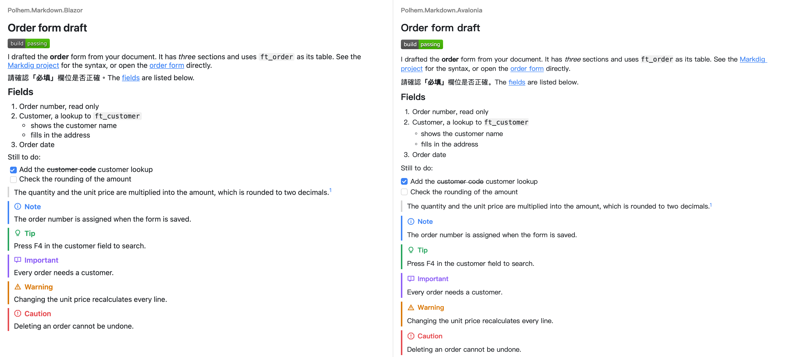
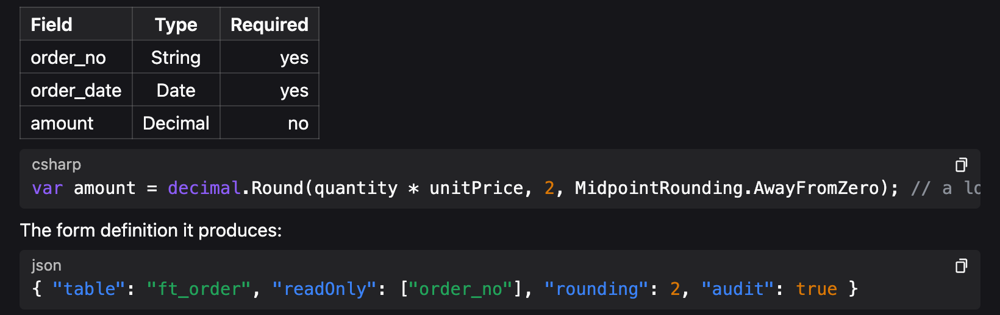
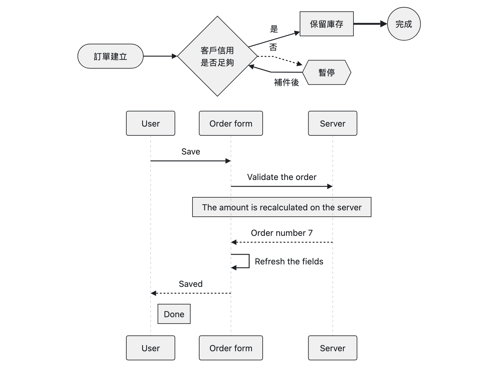
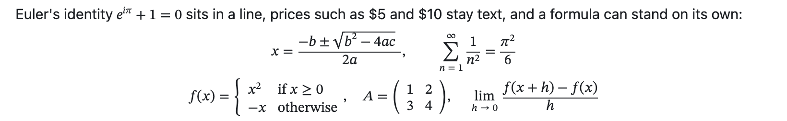
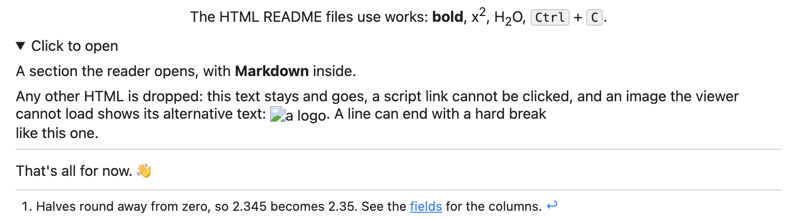
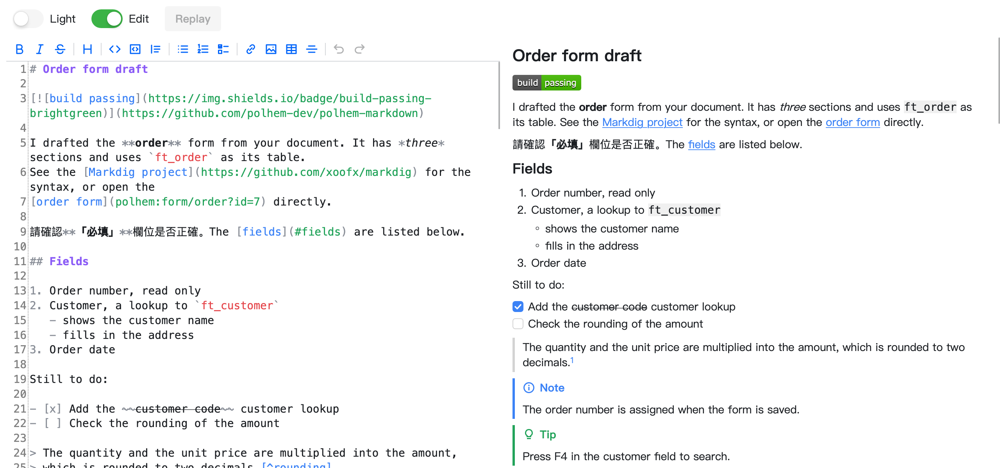
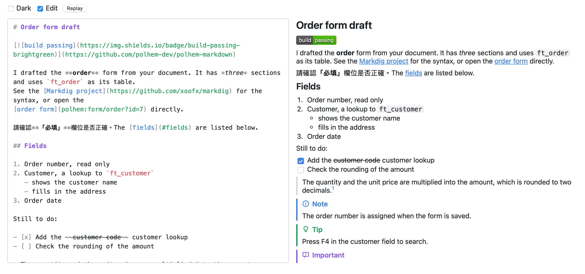

# Polhem.Markdown

**English** | [繁體中文](README.zh-TW.md)

[](https://github.com/polhem-dev/polhem-markdown/actions/workflows/build-ci.yml)
[](https://sonarcloud.io/project/overview?id=polhem-dev_polhem-markdown)
[](https://sonarcloud.io/project/overview?id=polhem-dev_polhem-markdown)
[](https://sonarcloud.io/project/overview?id=polhem-dev_polhem-markdown)
[](https://sonarcloud.io/project/overview?id=polhem-dev_polhem-markdown)
[](https://sonarcloud.io/project/overview?id=polhem-dev_polhem-markdown)

Markdown viewers for .NET that show the same text the same way on different front ends, and Markdown source editors for
Avalonia and Blazor. One package parses the text and applies the safety policy; a package for each UI framework renders
the result and edits the source.

| Package | For |
|---------|-----|
| `Polhem.Markdown` | Parsing (with [Markdig](https://github.com/xoofx/markdig)) and the safety policy shared by the viewers |
| `Polhem.Markdown.Avalonia` | A viewer control and a source editor control for Avalonia |
| `Polhem.Markdown.Blazor` | A viewer component for Blazor, rendering semantic HTML styled with CSS variables, and a source editor component |

The packages are published on [nuget.org](https://www.nuget.org/packages?q=Polhem.Markdown); the changes of each release
are in the [CHANGELOG](CHANGELOG.md). They are at 0.x: a minor version may still change the API, and the CHANGELOG says
when it does.

## What the viewers show



Both viewers render the same model, so a reply looks alike in a browser and in a desktop or mobile app. The picture
shows the start of the sample text in each.

### At a glance

| Syntax or capability | Written as, or what it does | Avalonia | Blazor |
|----------------------|-----------------------------|:--------:|:------:|
| Headings, emphasis, quotes, lists, rules | CommonMark | ✓ | ✓ |
| Strikethrough | `~~text~~` | ✓ | ✓ |
| Task lists | `- [x] done` | ✓ | ✓ |
| Tables with column alignment | `:--`, `:-:`, `--:` | ✓ | ✓ |
| Footnotes | `text[^note]` | ✓ | ✓ |
| GitHub alerts | `> [!NOTE]`, `[!TIP]`, `[!IMPORTANT]`, `[!WARNING]`, `[!CAUTION]` | ✓ | ✓ |
| Emoji shortcodes | `:wave:` | ✓ | ✓ |
| YAML front matter | Hidden | ✓ | ✓ |
| Links to a heading | `[setup](#setup)` scrolls to it | ✓ | ✓ |
| Code blocks | Language label, copy button, highlighting for common languages | ✓ | ✓ |
| Mermaid diagrams | Flowcharts and sequence diagrams, drawn without a script | ✓ | ✓ |
| Math | `$…$`, `$$…$$` and ` ```math `, laid out without a script | ✓ | ✓ |
| HTML that README files use | `<div align>`, `<details>`, `<sup>`, `<kbd>`, ``, `<picture>`; other HTML is dropped | ✓ | ✓ |
| Link schemes | Only allowed schemes can be clicked (`http`, `https`, `mailto` by default) | ✓ | ✓ |
| Image schemes | Only allowed schemes load (`https` by default) | ✓ | ✓ |
| SVG images | | Trusted badge hosts | Every allowed image |
| Selecting text | A drag runs across blocks; copying gives plain text, with tabs between table cells | ✓ | ✓ |
| Streaming | Set the text again as a reply arrives | ✓ | ✓ |
| Light and dark themes | | Brushes | CSS variables |
| Source positions | For keeping an editor in step | ✓ | ✓ |

The sections below and each viewer's README give the details.

- **GitHub Flavored Markdown**: headings, emphasis, ~~strikethrough~~, lists and task lists, quotes, tables with
  column alignment, footnotes, emoji shortcodes such as `:wave:`, and GitHub alerts (`> [!NOTE]`, `> [!TIP]`,
  `> [!IMPORTANT]`, `> [!WARNING]`, `> [!CAUTION]`). YAML front matter is hidden, and a link to a heading of the same
  text scrolls to it.
- **Code blocks** show their language and a copy button, and code in common languages such as C#, JSON, SQL, XML,
  JavaScript and Python is highlighted. Light and dark themes are both supported:

  

- **Mermaid diagrams**: flowcharts and sequence diagrams are drawn by the viewer itself, with no script. A diagram of
  another type shows as code.

  

- **Math** written as on GitHub, `$…$` in a line and `$$…$$` or a ` ```math ` block on its own, also without a script.
  Dollar signs in prose, such as prices, stay text.

  

- **The HTML README files use**, such as `<div align="center">`, `<details>`, `<sup>`, `<kbd>` and ``, becomes
  part of the text; any other HTML is dropped, and scripts with their content.

  

- **Safety**: only links with an allowed scheme (by default `http`, `https` and `mailto`) can be clicked, and only
  images from an allowed scheme (by default `https`) load. A host can add a scheme of its own and decide what such a
  link does.
- **Streaming**: the text can be set again as a reply arrives; the gallery's replay shows it.

Each package's README shows how to use its viewer:
[Avalonia](src/Polhem.Markdown.Avalonia/README.md), [Blazor](src/Polhem.Markdown.Blazor/README.md).

## The editor



`MarkdownEditor`, in `Polhem.Markdown.Avalonia` and in `Polhem.Markdown.Blazor`, edits Markdown as source, with a live
preview in `MarkdownViewer` beside it, not as rich text. The two editors color and edit a text the same way.

- **Colours the source the way the viewer reads it**: markers, headings, emphasis, inline code, links and their
  addresses, raw HTML and formulas, and fenced code with the viewer's highlighting.
- **Formats and list keys**: `ApplyFormat` (`ApplyFormatAsync` on Blazor) toggles bold, italic, strikethrough, inline code, links, images, headings, lists,
  task lists, quotes and code blocks, and inserts tables and horizontal rules, with Ctrl or Cmd and B, I, K or E for
  the inline ones. `CycleHeading` (`CycleHeadingAsync` on Blazor) steps a line through heading levels 1 to 3 and back to plain text. Enter
  continues a list, and Tab and Shift+Tab move an item in and out.
- **A toolbar** above the text, with a button for each format, the heading cycle, undo and redo. Its labels are
  English unless the host gives its own; `ShowToolbar = false` hides it.
- **Keeps in step with the viewer**: the editor reports the source at the top of its view and scrolls to a source
  offset; the viewer maps source offsets to positions and back, and a command-click asks for the source of what was
  clicked. The gallery wires the two together.
- **Its links cannot be opened from the source**: the viewer opens them after checking their scheme.
- **On Avalonia** it is built on AvaloniaEdit and works under any theme with no styles from the host.
- **On Blazor** the text is typed into a native textarea, so input methods and screen readers work as anywhere on the
  page, under interactive server, WebAssembly and auto rendering. It has no search panel yet.



Each package's README shows how to use its editor: [Avalonia](src/Polhem.Markdown.Avalonia/README.md),
[Blazor](src/Polhem.Markdown.Blazor/README.md).

## Samples

`samples/MarkdownGallery` shows every kind of node on a Semi theme, light or dark, with a replay that types the text in
chunks as a streamed reply arrives. Its Edit switch puts the editor beside the viewer, scrolling together.

```bash
dotnet run --project samples/MarkdownGallery.Desktop
dotnet run --project samples/MarkdownGallery.Blazor
dotnet run --project samples/MarkdownGallery.Wasm
```

The Blazor gallery shows the same text, so the two viewers can be compared side by side. Its Edit switch puts the Blazor
editor beside the viewer in the same way. `MarkdownGallery.Blazor` runs with interactive server rendering;
`MarkdownGallery.Wasm` runs the same page on standalone Blazor WebAssembly, in the browser with no server. Build CI
publishes it trimmed, so a change that breaks the Blazor package under trimming fails the build.

The iOS head is not in the solution, because it needs the iOS workload. On a Mac, build and start it on a simulator:

```bash
dotnet build samples/MarkdownGallery.iOS -c Release -p:RuntimeIdentifier=iossimulator-arm64
dotnet build samples/MarkdownGallery.iOS -c Release -t:Run -p:RuntimeIdentifier=iossimulator-arm64 -p:_DeviceName=":v2:udid=<simulator UDID>"
```

If the build says the iOS workload needs another Xcode version, point `DEVELOPER_DIR` at that version for the build.

## Building

```bash
dotnet build Polhem.Markdown.slnx --configuration Release
dotnet test Polhem.Markdown.slnx --configuration Release --no-build
```

## License

[MIT](LICENSE)
