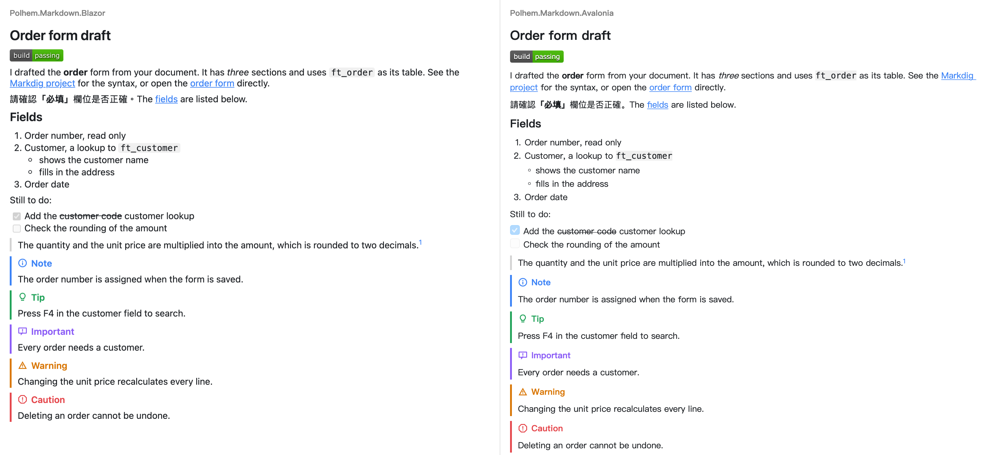
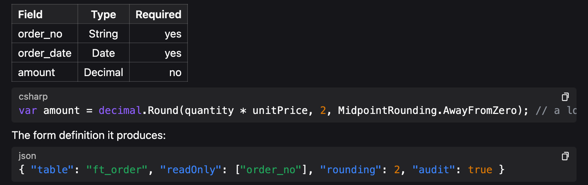
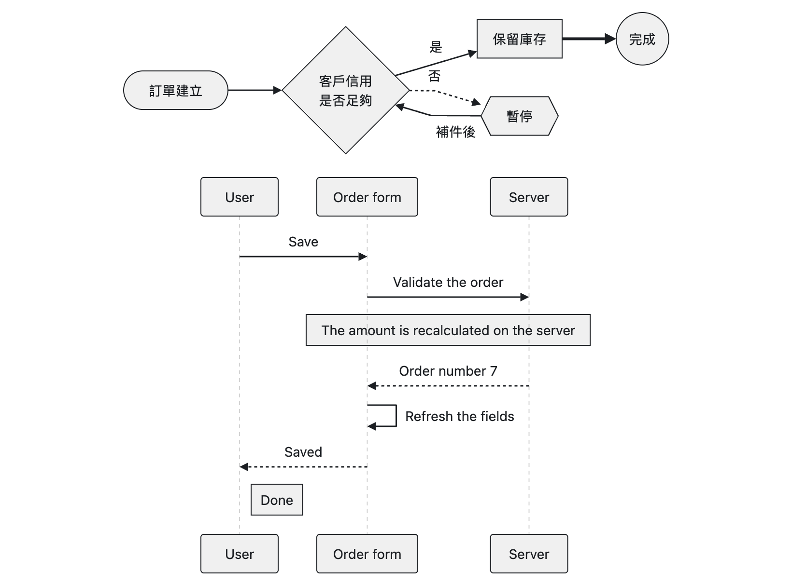
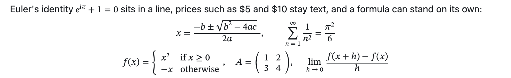
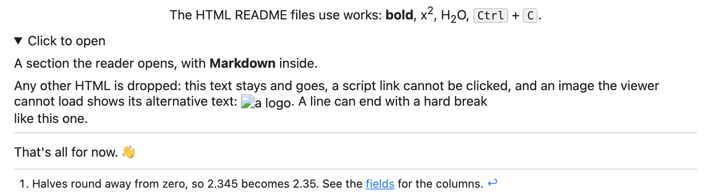

# Polhem.Markdown

[English](README.md) | **繁體中文**

[](https://github.com/polhem-dev/polhem-markdown/actions/workflows/build-ci.yml)
[](https://sonarcloud.io/project/overview?id=polhem-dev_polhem-markdown)
[](https://sonarcloud.io/project/overview?id=polhem-dev_polhem-markdown)
[](https://sonarcloud.io/project/overview?id=polhem-dev_polhem-markdown)
[](https://sonarcloud.io/project/overview?id=polhem-dev_polhem-markdown)
[](https://sonarcloud.io/project/overview?id=polhem-dev_polhem-markdown)

.NET 的 Markdown 檢視器，讓同一段文字在不同前端呈現一致。一個套件負責解析並套用安全政策，各 UI 框架的檢視器套件負責呈現結果。

| 套件 | 用途 |
|------|------|
| `Polhem.Markdown` | 解析（使用 [Markdig](https://github.com/xoofx/markdig)），以及各檢視器共用的安全政策 |
| `Polhem.Markdown.Avalonia` | Avalonia 的檢視器控制項 |
| `Polhem.Markdown.Blazor` | Blazor 的檢視器元件，輸出以 CSS 變數設定樣式的語意化 HTML |

套件發佈在 [nuget.org](https://www.nuget.org/packages?q=Polhem.Markdown)，各版變更見 [CHANGELOG](CHANGELOG.zh-TW.md)。
目前是 0.x：minor 版仍可能變更 API，CHANGELOG 會寫明。

## 檢視器支援的功能



兩個檢視器呈現的是同一個模型，所以同一段回覆在瀏覽器、桌面或行動 App 中看起來一致。上圖是範例文字開頭在兩邊的樣子。

- **GitHub Flavored Markdown**：標題、強調、~~刪除線~~、清單與待辦清單、引言、可設定欄位對齊的表格、註腳、
  `:wave:` 這類 emoji 短碼，以及 GitHub 警示區塊（`> [!NOTE]`、`> [!TIP]`、`> [!IMPORTANT]`、`> [!WARNING]`、
  `> [!CAUTION]`）。YAML front matter 會隱藏；連到同一段文字中標題的連結，點下後會捲動到該標題。
- **程式碼區塊**顯示語言與複製按鈕，C#、JSON、SQL、XML、JavaScript、Python 等常見語言會有語法上色。支援亮色與暗色主題：

  

- **Mermaid 圖表**：流程圖與循序圖由檢視器自行繪製，不執行任何腳本。其他類型的圖表以程式碼顯示。

  

- **數學公式**寫法與 GitHub 相同：行內用 `$…$`，獨立成段用 `$$…$$` 或 ` ```math ` 區塊，同樣不執行腳本。
  文中的金額等錢字號維持為文字。

  

- **README 常用的 HTML**，例如 `<div align="center">`、`<details>`、`<sup>`、`<kbd>`、``，會轉為文字的一部分；
  其他 HTML 會被捨棄，腳本連同內容一併移除。

  

- **安全**：只有允許的 scheme（預設 `http`、`https`、`mailto`）的連結可以點擊，只有允許的 scheme（預設 `https`）
  的圖片會載入。宿主可以加入自己的 scheme，並決定這類連結要做什麼。
- **串流**：回覆陸續送達時可以反覆設定文字，範例的「重播」功能可看到效果。

各檢視器支援的細節與色彩設定，見各自的 README：
[Avalonia](src/Polhem.Markdown.Avalonia/README.md)、[Blazor](src/Polhem.Markdown.Blazor/README.md)。

## 範例

`samples/MarkdownGallery` 以 Semi 主題（亮色或暗色）展示每一種節點，並可「重播」：把文字分段打出來，模擬串流回覆。

```bash
dotnet run --project samples/MarkdownGallery.Desktop
dotnet run --project samples/MarkdownGallery.Blazor
```

Blazor 版 Gallery 顯示同一份文字，方便兩個檢視器並排比對。

iOS head 需要 iOS workload，所以不在 solution 裡。在 Mac 上建置並於模擬器啟動：

```bash
dotnet build samples/MarkdownGallery.iOS -c Release -p:RuntimeIdentifier=iossimulator-arm64
dotnet build samples/MarkdownGallery.iOS -c Release -t:Run -p:RuntimeIdentifier=iossimulator-arm64 -p:_DeviceName=":v2:udid=<模擬器 UDID>"
```

若建置訊息說 iOS workload 需要另一個 Xcode 版本，建置時以 `DEVELOPER_DIR` 指向該版本。

## 建置

```bash
dotnet build Polhem.Markdown.slnx --configuration Release
dotnet test Polhem.Markdown.slnx --configuration Release --no-build
```

## 授權

[MIT](LICENSE)
