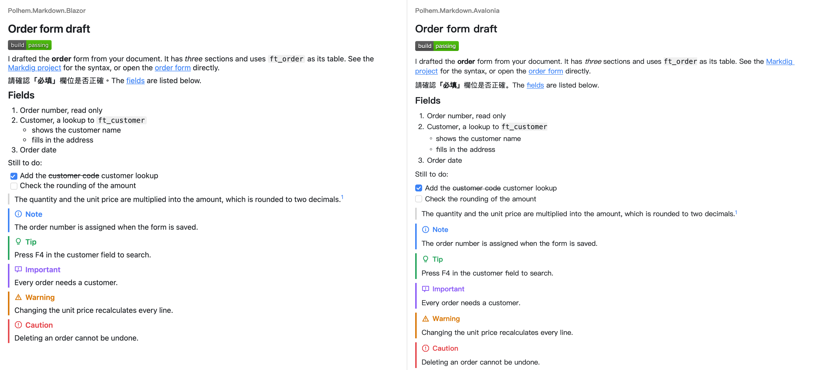
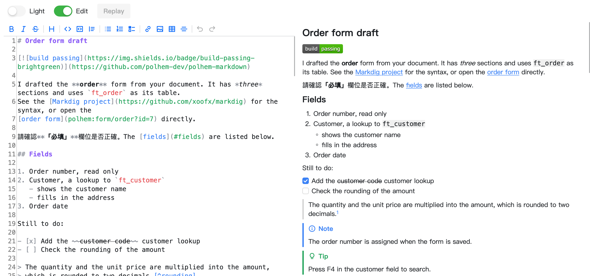

# Polhem.Markdown.Avalonia

A Markdown viewer control and a Markdown source editor control for Avalonia. The viewer renders the same model as
`Polhem.Markdown.Blazor`, so an Avalonia and a Blazor front end show the same text the same way.



## MarkdownViewer

Shows Markdown: GitHub Flavored Markdown, highlighted code, math, Mermaid diagrams and the HTML that README files use.
Raw HTML is never passed on, and only links and images with an allowed scheme open or load.

```xml
<Window xmlns:md="using:Polhem.Markdown.Avalonia">
  <md:MarkdownViewer Markdown="{Binding Reply}" LinkActivated="OnLinkActivated" />
</Window>
```

```csharp
// Without a handler that marks it handled, the viewer asks the operating system to open the link.
private void OnLinkActivated(object? sender, MarkdownLinkActivatedEventArgs e)
{
    OpenInApp(e.Uri);
    e.Handled = true;
}

// Resolve relative links and images against the document's address, and allow file images.
viewer.Options = new MarkdownOptions
{
    BaseUri = new Uri("https://example.com/docs/"),
    AllowedImageSchemes = { "file" },
};
```

Set `CjkFontFamily` when the text has Chinese, Japanese or Korean, so bold CJK text keeps its weight
([AvaloniaUI/Avalonia#18199](https://github.com/AvaloniaUI/Avalonia/issues/18199)):

```xml
<md:MarkdownViewer Markdown="{Binding Reply}"
                   CjkFontFamily="PingFang TC, Microsoft JhengHei UI, Noto Sans CJK TC" />
```

Text can be selected as in a browser: a drag runs from one block into the next, and scrolls the nearest scroll viewer
when it reaches its edge. Shift-click extends the selection, Ctrl+A (Cmd+A) selects the whole text, and Ctrl+C
(Cmd+C) copies it as plain text, with an empty line between blocks, a line break between list items and table rows,
and a tab between table cells. The text of a closed `<details>` section is left out.

`Headings` lists the text's headings for a table of contents, `HeadingsChanged` reports a change in them, and
`ScrollToHeading` scrolls one to the top of the view:

```csharp
outline.ItemsSource = viewer.Headings;   // each with Level, Text, Id and SourceOffset
viewer.HeadingsChanged += (_, _) => outline.ItemsSource = viewer.Headings;
outline.SelectionChanged += (_, _) =>
{
    if (outline.SelectedItem is MarkdownHeading heading)
    {
        viewer.ScrollToHeading(heading.Id);
    }
};
```

To mark the section being read, take the last heading whose `SourceOffset` is at or before `GetSourceOffset` at the
top of the view.

## MarkdownEditor

Edits Markdown as source on AvaloniaEdit, colored the way the viewer reads it, with a toolbar, format commands and list
keys. Put a `MarkdownViewer` beside it for a live preview:



```xml
<Grid ColumnDefinitions="*,*">
  <md:MarkdownEditor x:Name="Editor" Markdown="{Binding Text}" />
  <md:MarkdownViewer Grid.Column="1" Markdown="{Binding Text}" />
</Grid>
```

```csharp
Editor.ApplyFormat(MarkdownFormat.Bold);   // toggles bold on the selection, as Ctrl+B or Cmd+B does
Editor.CycleHeading();                     // plain text, then #, ##, ###, then plain text again
```

The toolbar's labels are English; give your own, or `null` to keep one. Set `ShowToolbar="False"` to lay out buttons of
your own instead:

```csharp
Editor.ToolbarLabels = item => item switch
{
    MarkdownToolbarItem.Bold => "粗體",
    MarkdownToolbarItem.Italic => "斜體",
    _ => null,
};
```

The editor brings the styles its AvaloniaEdit parts need, so it works under any theme. The gallery in the repository
keeps the editor and the viewer scrolling together.

Each member's XML documentation has the details. The package is at 0.x: a minor version may still change the API. See
the [repository](https://github.com/polhem-dev/polhem-markdown).
