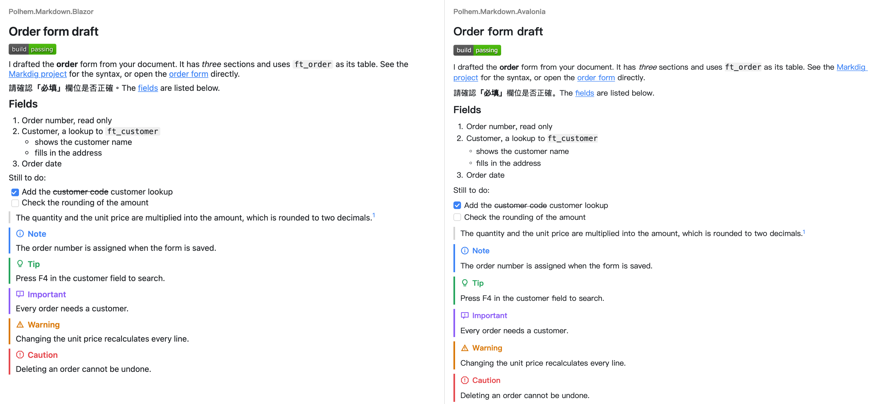
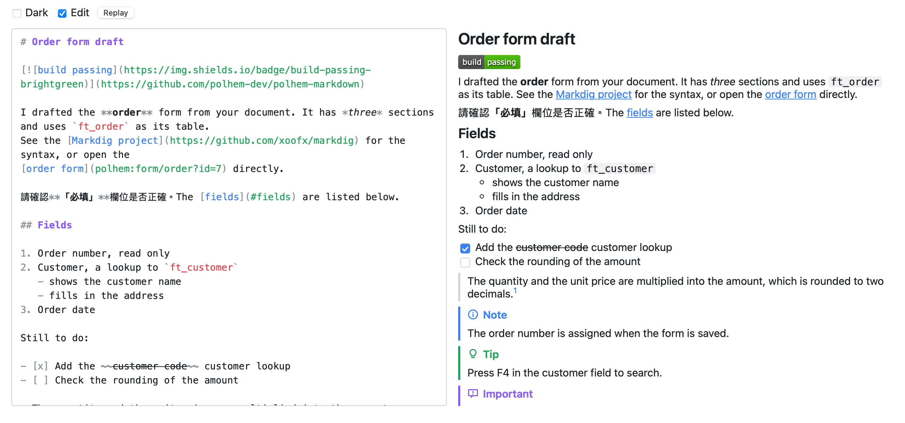

# Polhem.Markdown.Blazor

A Markdown viewer component that renders semantic HTML styled with CSS variables, and a Markdown source editor
component, for Blazor. The viewer renders the same model as `Polhem.Markdown.Avalonia`, so a Blazor and an Avalonia
front end show the same text the same way.



Link the stylesheet in the host page:

```html
<link rel="stylesheet" href="_content/Polhem.Markdown.Blazor/polhem-markdown.css" />
```

## MarkdownViewer

Shows Markdown: GitHub Flavored Markdown, highlighted code, math as MathML, Mermaid diagrams as SVG and the HTML that
README files use, all drawn without a script. Raw HTML is never added as markup, and only links and images with an
allowed scheme become links and images.

```razor
@using Polhem.Markdown
@using Polhem.Markdown.Blazor
@inject NavigationManager Navigation

<MarkdownViewer Markdown="@reply" Options="options" OnLinkActivated="OpenLink" />

@code {
    private string reply = "# Hello";

    // Resolve relative links and images against the document's address.
    private readonly MarkdownOptions options = new() { BaseUri = new Uri("https://example.com/docs/") };

    // With OnLinkActivated set, a click does not navigate; without it, the link opens in a new tab.
    private void OpenLink(MarkdownLinkActivatedEventArgs e) => Navigation.NavigateTo(e.Uri.ToString());
}
```

The viewer inherits the font and the text color of the page. The other colors and fonts are CSS variables; their list
and defaults are at the top of `polhem-markdown.css`:

```css
.pmd {
  --pmd-link: #0969da;
  --pmd-code-font: "JetBrains Mono", monospace;
}
```

Or let the viewer show the table of contents itself. `ShowOutline` puts a button in its top corner that opens the
headings floating over the text, and the pin in the list docks it as a column beside the text. Bind `OutlinePinned` to
keep it pinned when the page renders again, and set `OutlineSide` to move it to the right. The list stays in view with
`position: sticky`, so no element between it and the one that scrolls may clip with `overflow: hidden` (use
`overflow: clip`). The section being read is marked. `OutlineLabel`, `PinOutlineLabel` and `UnpinOutlineLabel`
translate the labels, and `--pmd-outline-bg` is the list's background.

```razor
<MarkdownViewer Markdown="@reply" ShowOutline="true" @bind-OutlinePinned="pinned" />
```

Set `ZoomImages` to open an image at full size over the page with a click or Enter, in a dialog where the wheel, a
pinch or + and - zoom it, a drag pans it, a double click switches between fitting the window and the image's own
size, and Escape or a click beside it closes it. An image inside a link opens the link instead. With
`OnImageActivated` set, the host shows the image its own way and the viewer opens nothing. The dialog's backdrop is
`--pmd-zoom-backdrop`.

```razor
<MarkdownViewer Markdown="@reply" ZoomImages="true" />
```

`Headings` lists the text's headings for a table of contents, `OnHeadingsChanged` reports a change in them, and
`ScrollToHeadingAsync` scrolls one to the top of the view and focuses it:

```razor
<MarkdownViewer @ref="viewer" Markdown="@reply" OnHeadingsChanged="h => headings = h"
                FirstVisibleSourceOffsetChanged="Follow" />

<nav>
    @foreach (var heading in headings)
    {
        <button class="@(heading == current ? "current" : "")"
                @onclick="() => viewer!.ScrollToHeadingAsync(heading.Id)">@heading.Text</button>
    }
</nav>

@code {
    private MarkdownViewer? viewer;
    private IReadOnlyList<MarkdownHeading> headings = [];
    private MarkdownHeading? current;

    // The section being read: the last heading that starts at or before the text at the top of the view.
    private void Follow(int offset) => current = headings.LastOrDefault(heading => heading.SourceOffset <= offset);
}
```

## MarkdownEditor

Edits Markdown as source in a native `<textarea>`, colored the way the viewer reads it, with a toolbar, line numbers,
format commands and list keys. It works under interactive server, WebAssembly and auto rendering. Put a `MarkdownViewer` beside it for a live
preview:



```razor
<div style="display: grid; grid-template-columns: 1fr 1fr; height: 30rem">
    <MarkdownEditor @ref="editor" @bind-Markdown="text" aria-label="Markdown source" />
    <MarkdownViewer Markdown="@text" />
</div>

@code {
    private MarkdownEditor editor = default!;
    private string text = "# Hello";

    // Toggles bold on the selection, as Ctrl+B or Command+B does.
    private Task Bold() => editor.ApplyFormatAsync(MarkdownFormat.Bold);
}
```

The toolbar's labels are English; give your own, or `null` to keep one. Set `ShowToolbar="false"` to lay out buttons of
your own instead:

```razor
<MarkdownEditor @bind-Markdown="text" ToolbarLabels="Label" />

@code {
    private static string? Label(MarkdownToolbarItem item) => item switch
    {
        MarkdownToolbarItem.Bold => "粗體",
        MarkdownToolbarItem.Italic => "斜體",
        _ => null,
    };
}
```

The editor fills the height its host gives it, and loads its own script module. Keep `--pmd-code-font` monospaced: the
colors are drawn behind the textarea and must line up with it. The gallery in the repository keeps the editor and the
viewer scrolling together.

Each member's XML documentation has the details. The package is at 0.x: a minor version may still change the API. See
the [repository](https://github.com/polhem-dev/polhem-markdown).
