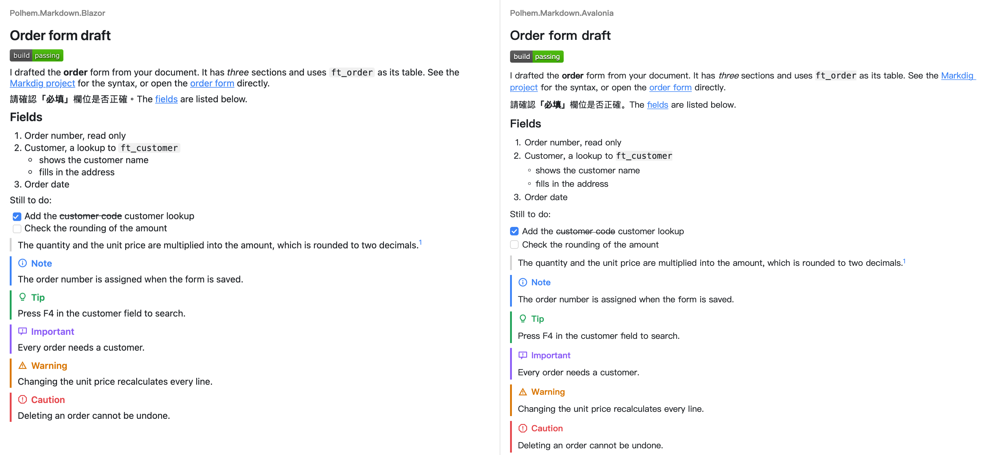

# Polhem.Markdown

Parses Markdown with [Markdig](https://github.com/xoofx/markdig) into the model that the Polhem.Markdown viewers render,
and applies one safety policy for all of them. Applications use it through a viewer package:

- `Polhem.Markdown.Avalonia`: a viewer control, a reader control with a table of contents, and a source editor control
  for Avalonia.
- `Polhem.Markdown.Blazor`: a viewer component, a reader component with a table of contents, and a source editor
  component for Blazor.

The packages are at 0.x: a minor version may still change the API. See the [repository](https://github.com/polhem-dev/polhem-markdown).
