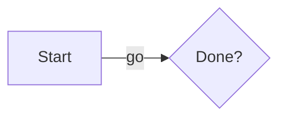

# Heading

A paragraph with *italic*, **bold**, `code`, a [link](https://example.com/) and a [link to the heading](#heading),
then a hard line break[^note]\
and the next line, with ~~struck~~ text.

1. one
2. two
   - nested
   - [x] a done task

> A quote.

> [!WARNING]
> An alert.

```csharp
var x = 1;
```



| Name | Qty |
|:-----|----:|
| pen  | 2   |

---

[^note]: A footnote.
